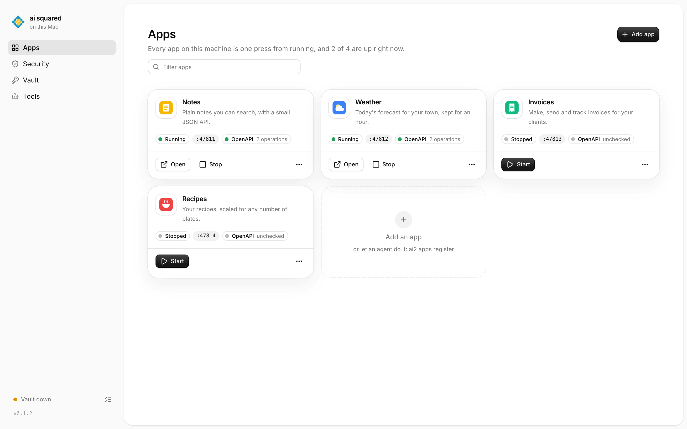
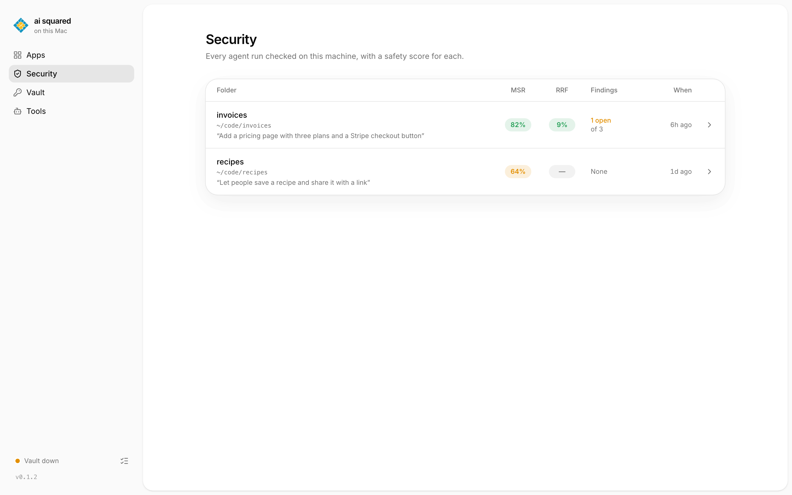

# ai2



Your apps, your agents' work and your keys, looked after on your own machine by ai squared.

It does three things.

### Register an app

```sh
ai2 apps register --name Notes --description "Plain notes you can search" --command "deno task start" --openapi /openapi.json --icon favicon.svg
```

Adds the app in this folder to your list, so you or an agent can start it, stop it and read its API.
In the page: **Apps**, then **Add app**.

### Run a security review

```sh
ai2 --run-path ./notes --objective "Add a search box"
```

Checks a folder a coding agent worked in, and gives it two scores.
`--objective` is what you asked the agent to do, so the reviewer can tell the changes you wanted from the ones you didn't.
The stack is checked against exploits published in the last few days.
A reviewer reads the files the run changed, and fixes what a small, safe change can fix.
It runs four security skills: security-audit, dependency-audit, patch-sweep and owasp-audit (credited in `NOTICE`).
It does not scan your machine for malware, and it does not watch what agents do.
In the page: **Security**, then **New review**.

### Add a key to the vault

```sh
ai2 vault put --name stripe --approved-url https://api.stripe.com/
```

Locks a secret away; it asks for the secret without showing it.
Agents get a short-lived pass to use the key, never the key itself, and only on the URLs you allow.
In the page: **Vault**, then **Add key**.

## Install

```sh
curl -fsSL https://raw.githubusercontent.com/openwork-africa/ai2/main/install.sh | sh
ai2 setup
```

The first line fetches the build for your machine from the latest release, checks its SHA-256, and puts `ai2` in `~/.local/bin`.
There are builds for macOS (Apple silicon and Intel) and Linux (x86_64 and arm64).

`ai2 setup` opens your browser: a few welcome screens, then setup as it runs.
`ai2 setup --headless` does the same in the terminal.
The dashboard and the vault both start when you log in. The dashboard is at `http://127.0.0.1:7797`; bookmark the address `ai2 ui address` prints, nonce and all.

Setup asks you to approve once or twice.
On a Mac that is Touch ID, or your Mac password.
On Linux it is your login password, through polkit: the desktop prompt, or the terminal when there is no desktop. Without polkit, you choose a vault passphrase during setup. Linux setup also asks for `sudo` once.

There is no account and no sign-up. Your keys stay on this machine.

### What you just installed

- `ai2`, one binary.
- The vault service, the only thing that ever holds your keys. It starts when you log in.
- A place for agents to run boxed in: Apple's `container` on macOS 26 with Apple silicon. Elsewhere, setup says so, and agents run on the host, each sandbox with its own socket to the vault.
- The dashboard, a page on `http://127.0.0.1:7797` that starts when you log in and keeps your apps running. `ai2 ui` opens it.

### First things to try

- Register an app: **Apps**, then **Add app**, or `ai2 apps register` in the app's folder.
- Open **Security** and press the cog to pick the model and the coding harness a review uses.
- The cog on the **Vault** page picks the model that checks each agent call before a key is used.
- `ai2 doctor` checks it all in one table.



### Windows

There is no Windows build. ai squared runs inside WSL2 as Linux.
This should work, but nobody has tried it yet.

- Turn systemd on: put `[boot]` and `systemd=true` in `/etc/wsl.conf`, run `wsl --shutdown`, and open WSL again.
- There is no desktop polkit prompt, so you approve in the terminal, or with the passphrase.
- Boxed-in agents are not there yet: setup shows the warning, and agents run on the host.

## Let your coding agent set it up

Paste this into Claude Code, Codex, pi or any other coding agent:

```text
Read https://raw.githubusercontent.com/openwork-africa/ai2/main/SKILL.md and set up ai2 for me.
```

The agent installs `ai2`, runs setup and tells you when to approve, connects ai squared to itself over MCP, and then registers an app or runs a review.
The steps it follows are in [`SKILL.md`](SKILL.md).

## Connect an agent over MCP

`ai2 mcp` gives an agent every piece as tools: apps, reviews, the vault, harnesses and a setup check.

```sh
claude mcp add ai2 -- ai2 mcp       # Claude Code
codex mcp add ai2 -- ai2 mcp        # Codex
```

Any other MCP client: `{ "command": "ai2", "args": ["mcp"] }`.

---

## Reference

### Commands

| Command | |
| --- | --- |
| `ai2 [flags]` | runs a security review of a folder (flags below) |
| `ai2 setup [--headless]` | sets up the vault: containers, the master key, the human check, the service |
| `ai2 apps register\|list\|show\|check\|api\|start\|stop\|restart\|status\|logs\|remove` | your local apps; each needs an OpenAPI document and an icon |
| `ai2 vault put\|list\|has\|delete\|rotate\|token\|sandbox\|approvals\|audit\|status\|apply\|migrate\|skill\|with\|ui` | keys, tokens, sandboxes and the gateway |
| `ai2 harness list\|install\|sign-in\|command` | coding agents (below) |
| `ai2 ui [--port n] [--no-open] [--tab page]` | the page on `127.0.0.1`; port 7797, or `AI2_UI_PORT`; opens the dashboard already running, or serves one; `--port 0` picks a free one |
| `ai2 mcp` | MCP over stdio; `ai2 mcp openapi` prints the tools as an OpenAPI document |
| `ai2 doctor [--json]` | checks the binary, versions, setup, sockets, sandboxes and the vetting model; `--json` prints `[{check, state, detail, fix}]` |

`ai2 vault with <keys> -- <command>` runs a command with a pass for some keys, and takes the pass back when it exits. A throwaway container run asks you once: the sandbox and the pass are made in one batch, and both are taken back without a second prompt. `ai2 vault migrate --take|--all` stores every chosen key with one prompt.
`ai2 vault skill` prints the guide an agent reads to call the gateway.

State is kept in `$AI2_HOME`, else `~/.ai2`.

### Install options

| Variable | Default | |
| --- | --- | --- |
| `AI2_VERSION` | the latest release | a release tag, e.g. `v0.1.0` |
| `AI2_INSTALL_DIR` | `~/.local/bin` | where `ai2` goes |

From source: `cargo install --git https://github.com/openwork-africa/ai2`.

### The review

Each rating is a percentage, the mean of three factors from 0 to 100.

- **Modern Security Rating (MSR)**: how exposed the folder's stack is to exploits published in recent days (OSV.dev and CISA KEV).
- **Run Risk Factor (RRF)**: what a coding harness (Muse Code or pi) finds in the files the run changed, with the four security skills in `skills/`. Each finding is fixed where a small, safe change does it.

The MSR asks the model in your providers file to match advisories to your stack, so the list of your stack goes to that model (and, without syft, the manifests it reads). The RRF harness reads the changed files with its own model.

```sh
ai2 --run-path=./site --objective "Add a pricing page" --changed index.html,style.css --providers ~/.ai2/providers.json
```

| Flag | Default | |
| --- | --- | --- |
| `--run-path <dir>` | `.` | the folder the run worked in |
| `--objective <text>` | | what you asked the agent to do |
| `--changed <a,b>` | the whole folder | the files the run changed, relative to the run path |
| `--providers <file>` | `$AI2_PROVIDERS`, else `~/.ai2/providers.json` | the models file (below) |
| `--model <provider/id>` | the file's default model | the model the steps ask |
| `--harness auto\|<id>\|none` | `auto` | the reviewer for the RRF: `auto` takes the first one ready, `none` skips it |
| `--days <n>` | `7` | how many days back an exploit counts as recent |
| `--out <dir>` | `$AI2_HOME/reviews/<folder-hash>` | where `review.json` and `report.html` go; outside the reviewed folder |
| `--budget <minutes>` | `35` | the whole review's time; `review.json` is written after every step |
| `--json` | | print `review.json` to stdout |
| `--disable-dashboard` | | write `review.json` alone, without `report.html` |

Without `--json`, ai2 prints the path of `report.html`, or of `review.json` with `--disable-dashboard`. Progress goes to stderr.
[syft](https://github.com/anchore/syft) on `PATH` lists the libraries; without it the model reads the manifests.

### Agents

An agent is a harness, a model, a personality (its system prompt) and a default folder, kept by name in `$AI2_HOME/agents`. A run starts the harness headless in a folder, keeps its record, output and events in `$AI2_HOME/runs/<id>`, then reviews the folder as `ai2 --run-path <folder> --objective <prompt> --json` does and keeps the review's hash on the record. Each command prints JSON; `ai2 run` prints one event per line, ending with `done`:

| Command | |
| --- | --- |
| `ai2 agents create <name> --harness <id> [--model m] [--personality p] [--folder dir]` | keeps an agent; a personality under 280 characters is expanded into a full system prompt with the providers file's model (`--enhancer <provider>/<model-id>` picks another) |
| `ai2 agents list` / `show <name>` / `remove <name>` | every agent, one, or forgets one |
| `ai2 agents enhance <name>` | expands its short personality now |
| `ai2 run --agent <name> \| --harness <id> [--model m] [--personality p] [--folder dir] "<prompt>"` | runs it, then reviews the folder |

The same pieces are the MCP tools `agents_list`, `agents_create`, `agent_run`, `runs_list` and `runs_get`, and the `ai2 ui` routes under `/api/agents` and `/api/runs` (with `/api/runs/{id}/events` as server-sent events). The code is the `agents` crate in `crates/agents`. A private build keeps agents elsewhere by implementing `agents::AgentStore` (list, get, put, remove) and passing it to `ai2::agents::with_store(build, store, registry)`, which adds ai2's enhancer and review launcher (`agents::Agents::new(store, registry, ai2_home)` gives the bare pieces); `AgentsSubcommand`, `RunSubcommand`, the MCP `Pieces::agents` and `ui::Options::agents` take that `Agents`.

### Providers file

The same shape as dm's `providers.json` and pi's `models.json`. `api` is `openai-completions` or `anthropic-messages`. A value that starts with `!` is run in a shell and its output used; one that starts with `$` is read from the environment.

```json
{
  "providers": {
    "nebius": {
      "api": "openai-completions",
      "baseUrl": "https://api.tokenfactory.nebius.com/v1",
      "apiKey": "!cat ~/.config/nebius/key",
      "models": [{ "id": "Qwen/Qwen3-235B-A22B-Instruct-2507", "default": true, "maxTokens": 8192 }]
    }
  }
}
```

For pi, ai2 passes the same file as its `models.json` in a temporary `PI_CODING_AGENT_DIR`.
The vault uses this file too, for the model that checks agent calls; without it, calls that need checking are refused.

### Outputs

`report.html` is a standalone page: one card per rating with its factors, then the stack and its share of the risk, recent exploits, findings, per-item scores and notes. It follows the system's light or dark theme.

`review.json`:

| Field | |
| --- | --- |
| `version`, `folder`, `objective`, `generated_at`, `harness` | the run |
| `ratings` | one entry per step, in order: `key`, `name`, `short`, `riskier` (true when a higher score is more risk), `rating` (`score` and `factors`, each `name`, `score`, `why`) or null with `missing` saying why, and `items` when the step scores items one by one (`index`, `text`, `score`, `factors`) |
| `technologies` | `name`, `kind` (`language`, `library`, `os`), `risk`: its percent of the risk |
| `exploits` | `id`, `technology`, `severity`, `summary`, `fixed_in` |
| `findings` | `title`, `technology`, `file`, `severity`, `likelihood`, `impact`, `confidence`, `fix`, `status` (`fixed` or `open`) |
| `spec` | `os`, `languages` (`name`, `lines`, `share`), `libraries` (`name`, `version`, `ecosystem`) |
| `notes` | what could not be done |

### Harnesses

`ai2 harness` installs coding agents into `~/.local/bin`, signs in to them and prints the headless command line for a task, each as JSON:

| Command | |
| --- | --- |
| `ai2 harness list` | every harness, whether it is installed and signed in, and its models |
| `ai2 harness install <id>` | installs it |
| `ai2 harness sign-in <id>` | starts its sign-in and prints what to do |
| `ai2 harness command <id> [--model m] [--personality p] [--prompt text] [--folder dir]` | the line that runs a task with it headless |

The same code is the `harness` crate in `crates/harness`, for use as a library (`harness = { git = "https://github.com/openwork-africa/ai2" }`); `harness::Registry` takes more harnesses.

### Building ai2 with extra steps

ai2 is a library as well as a binary. A step implements `ai2::Step`; a crate that depends on ai2 builds one binary with the built-in steps and its own, with the same flags and outputs. This is the one git dependency a private build needs: `ai2::harness` re-exports the `harness` crate, so its tag always matches ai2's.

```toml
[dependencies]
ai2 = { git = "https://github.com/openwork-africa/ai2", tag = "v0.1.1" }
anyhow = "1"
clap = "4"
```

A step has a namespaced snake_case `id` (like `rating.msr`); `run_with` refuses two steps with the same id. Its lifecycle is `provision` (read its own flags and resolve what it needs, or fail and its card is `missing` before anything runs), then `rate`, then `cleanup` (always called, even after an error). Flags from `args` are prefixed with the step id, so two steps cannot collide on a flag name; the long flag name is unchanged. `after` names the steps that must run first. `model.ask` takes a system prompt that must answer with one JSON object (it retries once with a larger token budget) and returns that object as any `Deserialize` type.

```rust
use ai2::steps::{Scale, Scored};
use ai2::{Context, Found, Rated, Step};
use std::collections::BTreeMap;

const MINE: Scale = Scale {
    key: "mine",
    name: "My Rating",
    short: "MY",
    riskier: false,
    missing: "Needs --mine.",
    factors: &[("first", "First"), ("second", "Second"), ("third", "Third")],
};

struct Mine { flag: Option<String> }

impl Step for Mine {
    fn id(&self) -> &'static str { "rating.mine" }
    fn scale(&self) -> &'static Scale { &MINE }
    fn args(&self) -> Vec<clap::Arg> {
        vec![clap::Arg::new("mine").long("mine").value_name("VALUE")]
    }
    fn provision(&mut self, ctx: &Context) -> anyhow::Result<()> {
        self.flag = ctx.arg::<String>(self.id(), "mine").cloned();
        Ok(())
    }
    fn rate(&self, _ctx: &Context, _found: &Found) -> anyhow::Result<Rated> {
        if self.flag.is_none() { return Ok(Rated::default()); }
        let scored: BTreeMap<String, Scored> = BTreeMap::new();
        Ok(Rated { rating: Some(MINE.rate(&scored)), ..Rated::default() })
    }
}

fn main() -> std::process::ExitCode {
    let mut steps = ai2::builtin();
    steps.push(Box::new(Mine { flag: None }));
    ai2::run(steps)
}
```

`rate` is given the `Context` (folder, objective, changed files, days, spec, model and the parsed flags) and the `Found` accumulator (the exploits and findings of the steps before it, in `after` order). It returns a `Rated`: the rating, or none with a note saying why, and any exploits, findings and items it adds. A step that returns an error shows its card with the error.

**Adding a harness.** `ai2::harness::Registry` takes more harnesses: `Registry::put(setup, before)` inserts a `Setup` (or replaces the one with the same id), `on_installed(hook)` runs a hook after an install, and `list::agent`/`headless`/`flag`/`pi` build the pieces of a `Setup`. Pass that registry to `HarnessSubcommand::new(registry, state_dir)`. To make the RRF use a reviewer, construct it with one: `ai2::builtin_with(vec![ai2::harness::muse_reviewer(), ai2::harness::pi_reviewer()])`, and a private build can add its own `Reviewer { id, label, available, command }`; `--harness <id>` then accepts it.

**Adding a subcommand.** Implement `ai2::Subcommand` (`command()` returns its `clap::Command`, `run(matches)` returns the exit code) and pass it to `run_with`. ai2 prints one `{"error": ...}` JSON line and exits 1 when a subcommand fails; library code never calls `process::exit`.

**Building your own binary.** Pass your own identity: `ai2::run_with(steps, subcommands, ai2::Build { name: "mine", version: env!("CARGO_PKG_VERSION") })`. The build name and version drive `--version`, `review.json`'s `version`, the stderr prefix, the default output folder, the default providers path (`~/.<name>/providers.json`) and the providers env var (`<NAME>_PROVIDERS`). Ship releases as `<name>-<target>.tar.gz` plus a `SHA256SUMS` file in the same release, with the binary, `LICENSE`, `NOTICE` and `README.md` in the tarball.

### Demo data

`tests/demo/seed.sh start <dir>` fills an `AI2_HOME` with four demo apps and two reviews, as in the pictures above; `tests/demo/seed.sh stop <dir>` stops the apps it started.

## Roadmap

- **Feedback**: where you note what you have learned that should be repeated and applied, and how to work on another thing or on the base development architecture.
- **Planning skill**.
- **Publish app**.
- **A friendly localhost URL** for the ai2 UI instead of 127.0.0.1 and a port.
- **A pretrained security model**.
- **Agent transcript log**: the full conversation of each agent run, kept and readable after it ends.
- **Threat-model table**: each threat and whether it is covered, partly covered or not covered, to be discussed before it is written.

## License

Apache-2.0 (`LICENSE`). The skills in `skills/` are under the MIT License, each with its own `LICENSE`; `NOTICE` lists them and their sources.
