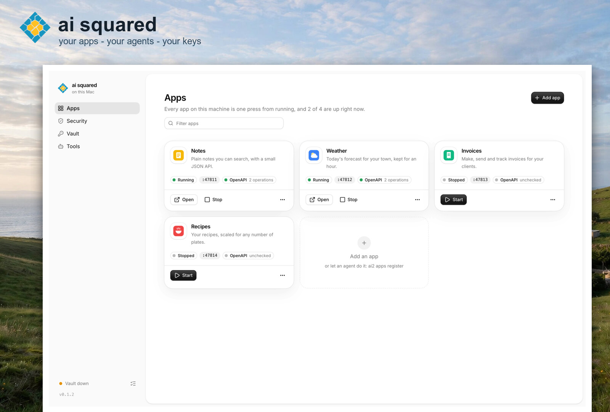

# ai squared

Your apps, your agents' work and your keys, looked after on your own machine by ai squared.

## Install

```sh
curl -fsSL https://raw.githubusercontent.com/openwork-africa/ai2/main/install.sh | sh
ai2 setup
```

The first line fetches the build for your machine from the latest release, checks its SHA-256, and puts `ai2` in `~/.local/bin`.
There are builds for macOS (Apple silicon and Intel) and Linux (x86_64 and arm64).

`ai2 setup` opens your browser: a few welcome screens, then setup as it runs.
`ai2 setup --headless` does the same in the terminal.
The dashboard and the vault both start when you log in. The dashboard is at `http://127.0.0.1:7797`; bookmark the address `ai2 ui address` prints, nonce and all.

Setup asks you to approve once or twice.
On a Mac that is Touch ID, or your Mac password.
On Linux it is your login password, through polkit: the desktop prompt, or the terminal when there is no desktop. Without polkit, you choose a vault passphrase during setup. Linux setup also asks for `sudo` once.

There is no account and no sign-up. Your keys stay on this machine.

### What you just installed

- `ai2`, one binary.
- The vault service, the only thing that ever holds your keys. It starts when you log in.
- A place for agents to run boxed in: Apple's `container` on macOS 26 with Apple silicon. Elsewhere, setup says so, and agents run on the host, each sandbox with its own socket to the vault.
- The dashboard, a page on `http://127.0.0.1:7797` that starts when you log in and keeps your apps running. `ai2 ui` opens it.

It does three things.

### Register an app

```sh
ai2 apps register --name Notes --description "Plain notes you can search" --command "deno task start" --openapi /openapi.json --icon favicon.svg
```

Adds the app in this folder to your list, so you or an agent can start it, stop it and read its API.
In the page: **Apps**, then **Add app**.

### Run a security review

```sh
ai2 --run-path ./notes --objective "Add a search box"
```

Checks a folder a coding agent worked in, and gives it two scores.
`--objective` is what you asked the agent to do, so the reviewer can tell the changes you wanted from the ones you didn't.
The stack is checked against exploits published in the last few days.
A reviewer reads the files the run changed, and fixes what a small, safe change can fix.
It runs four security skills: security-audit, dependency-audit, patch-sweep and owasp-audit (credited in `NOTICE`).
It does not scan your machine for malware, and it does not watch what agents do.
In the page: **Security**, then **New review**.

### Add a key to the vault

```sh
ai2 vault put --name stripe --approved-url https://api.stripe.com/
```

Locks a secret away; it asks for the secret without showing it.
Agents get a short-lived pass to use the key, never the key itself, and only on the URLs you allow.
In the page: **Vault**, then **Add key**.

### First things to try

- Register an app: **Apps**, then **Add app**, or `ai2 apps register` in the app's folder.
- Open **Security** and press the cog to pick the model and the coding harness a review uses.
- The cog on the **Vault** page picks the model that checks each agent call before a key is used.
- `ai2 doctor` checks it all in one table.


### Windows

There is no Windows build. ai squared runs inside WSL2 as Linux.
This should work, but nobody has tried it yet.

- Turn systemd on: put `[boot]` and `systemd=true` in `/etc/wsl.conf`, run `wsl --shutdown`, and open WSL again.
- There is no desktop polkit prompt, so you approve in the terminal, or with the passphrase.
- Boxed-in agents are not there yet: setup shows the warning, and agents run on the host.

## Let your coding agent set it up

Paste this into Claude Code, Codex, pi or any other coding agent:

```text
Read https://raw.githubusercontent.com/openwork-africa/ai2/main/SKILL.md and set up ai2 for me.
```

The agent installs `ai2`, runs setup and tells you when to approve, connects ai squared to itself over MCP, and then registers an app or runs a review.
The steps it follows are in [`SKILL.md`](SKILL.md).

## Connect an agent over MCP

`ai2 mcp` gives an agent every piece as tools: apps, reviews, the vault, harnesses and a setup check.

```sh
claude mcp add ai2 -- ai2 mcp       # Claude Code
codex mcp add ai2 -- ai2 mcp        # Codex
```

Any other MCP client: `{ "command": "ai2", "args": ["mcp"] }`.

---

## Reference

The full reference lives in its own files:

- [Commands](docs/commands.md)
- [Install options](docs/install-options.md)
- [The review](docs/review.md)
- [Agents](docs/agents-guide.md)
- [Providers file](docs/providers.md)
- [Outputs](docs/outputs.md)
- [Harnesses](docs/harnesses.md)
- [Building ai2 with extra steps](docs/building.md)
- [Demo data](docs/demo-data.md)

## Roadmap

- **Feedback**: where you note what you have learned that should be repeated and applied, and how to work on another thing or on the base development architecture.
- **Planning skill**.
- **Publish app**.
- **A friendly localhost URL** for the ai2 UI instead of 127.0.0.1 and a port.
- **A pretrained security model**.
- **Agent transcript log**: the full conversation of each agent run, kept and readable after it ends.
- **Threat-model table**: each threat and whether it is covered, partly covered or not covered, to be discussed before it is written.

## License

Apache-2.0 (`LICENSE`). The skills in `skills/` are under the MIT License, each with its own `LICENSE`; `NOTICE` lists them and their sources.
